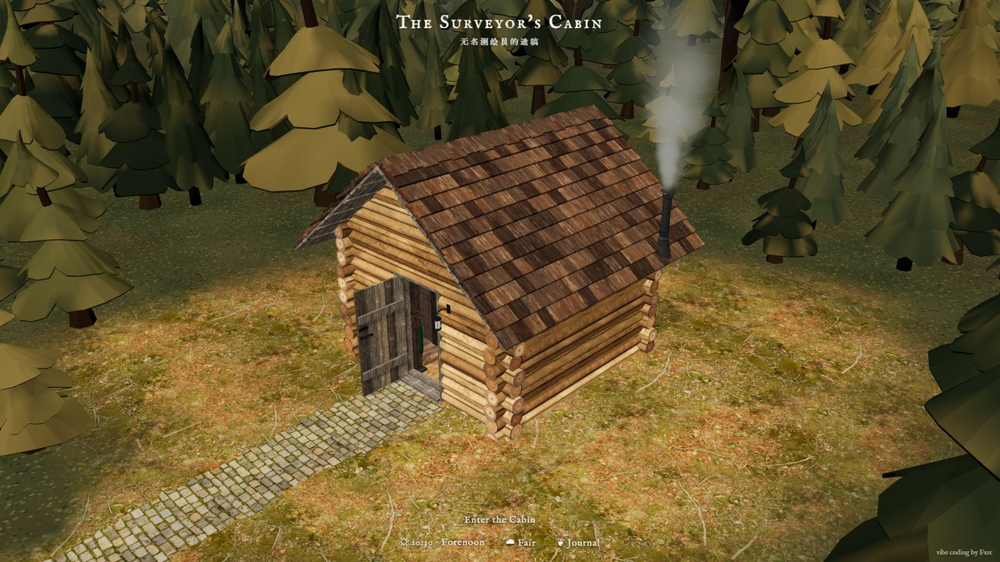
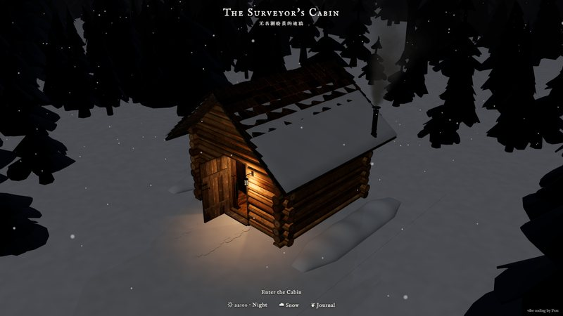
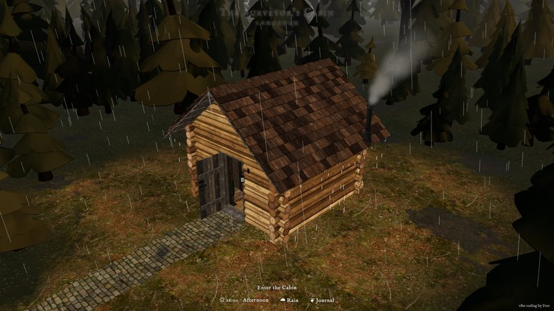
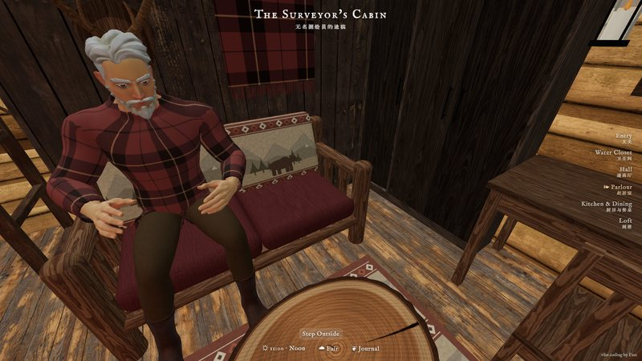
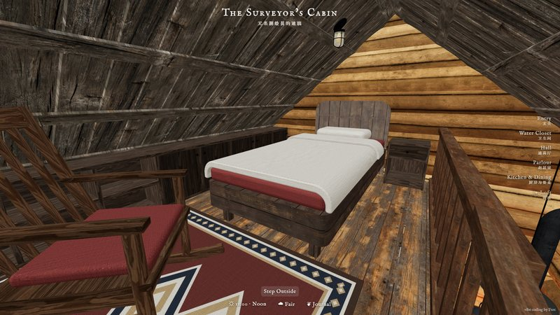

<div align="center">

# The Surveyor's Cabin

**A log cabin in a northern forest that you can walk into, in your browser.**
The owner left one day and never came back. The stove is still warm, the kettle is on, and every object in the house has a story to tell.

[**▶ Open it in your browser**](https://fxrcred.github.io/log-cabin/) · [中文说明](README.zh.md) · three.js · no build step · MIT

<a href="https://fxrcred.github.io/log-cabin/"></a>

</div>

## What's inside

**The world goes on without you.**
- A full day passes in six minutes: sunrise, noon, dusk, then moonlight and stars. When it gets dark every lamp in the cabin lights itself.
- Seven kinds of weather: Fair, Overcast, Rain, Thunderstorm, Snow, Blizzard, Fog. It changes on its own every few minutes, or pick one yourself.
- Rain leaves puddles and the eaves keep dripping after it stops. Snow piles up on the roof and the trees, and one day the whole roof load slides off and lands in the yard.
- Chimney smoke drifts with the wind. Lightning comes in bursts of three to five flashes.

**Walk in and look around.**
- The opening shot flies down a cobblestone path through ten thousand trees to the front door.
- Six rooms: Entry, Water Closet, Hall, Parlour, Kitchen & Dining, Loft. The camera flies from one to the next.
- Click almost anything (the greatcoat, the snowshoes, the field books on the desk) for a card with its story, in old-fashioned English with the Chinese original underneath.
- Things react when you touch them. Doors open, lamps switch on and off, the stove fire can be put out and relit, the kettle boils and lifts its lid, the taps run, the rocking chair rocks, the door curtain ties itself back.
- The **Journal** holds the whole tale of *the Nameless Surveyor's Last Papers*: prologue, the man himself, and an epilogue.

**Someone is still here.**
- An old man sits on the settee. Click him and he gets up and potters around the cabin.
- Choose *Take His Place* to walk in first person (WASD, Shift to hurry). Climb the ladder to the loft, and take the pans and knives down from the wall to turn them over in your hands (E to take, right mouse to rotate).

<table>
<tr>
<td></td>
<td></td>
</tr>
<tr>
<td></td>
<td></td>
</tr>
</table>

Works on desktop and phones (touch to orbit, fewer particles and trees on mobile). The page makes no requests to outside servers: three.js, decoders and fonts are all in the repo, so it also loads on networks where CDNs are blocked.

## Run it locally

Any static file server works. With Python:

```
git clone https://github.com/FxrcRed/log-cabin.git
cd log-cabin
python -m http.server 8765
```

Then open http://127.0.0.1:8765/. Opening `index.html` directly from disk won't work, since browsers block loading `.glb` models over `file://`.

## How it's made

- **The cabin** was modelled in Rhino with real furniture dimensions (about 3.5 × 3.5 m inside, one storey plus a loft) and exported to `cabin.glb` with Draco compression. The page groups meshes by Rhino layer name, which is how it knows which part is a door, a lamp or a lid.
- **The old man** is a Quaternius base character, dressed and animated in Blender (the clothes are built from the body mesh) and exported to `characters/man.glb`.
- **Everything else is code** in a single `index.html` (three.js r169, ES modules, no bundler): the sky and sun, weather particles, the snow and puddle shaders, smoke, water, fire, the camera flights and the first-person controls. Collision and picking use [three-mesh-bvh](https://github.com/gkjohnson/three-mesh-bvh).
- **The story** was written in Chinese and translated into period English. Every clickable object has its own entry.

Built by vibe coding with Claude.

## Credits

| | Source | License |
|---|---|---|
| Trees | [Quaternius](https://quaternius.com/), via [poly.pizza](https://poly.pizza/) | CC0 |
| Character and animations | Quaternius *Universal Base Characters* and *Universal Animation Library* | CC0 |
| English font | IM Fell English by Igino Marini | SIL OFL 1.1 |
| Chinese font | [Huiwen Mincho Improved](https://github.com/bosswnx/huiwenmincho-improved) (subset) | CC0 |
| Libraries | [three.js](https://threejs.org/), [three-mesh-bvh](https://github.com/gkjohnson/three-mesh-bvh), [Draco](https://github.com/google/draco) | MIT, MIT, Apache 2.0 |

The rest (code, cabin model, story) is © Fxrc under the [MIT License](LICENSE).
